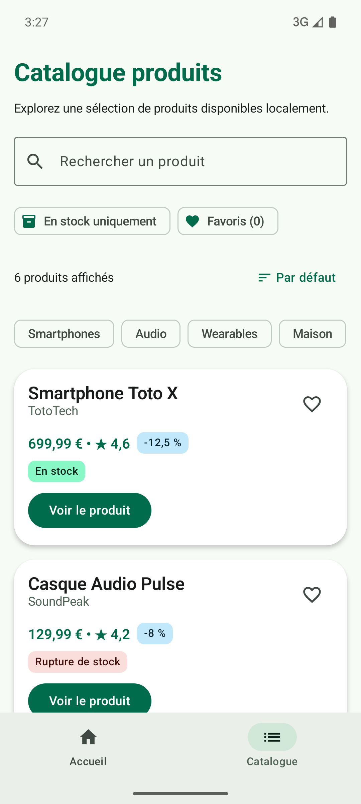
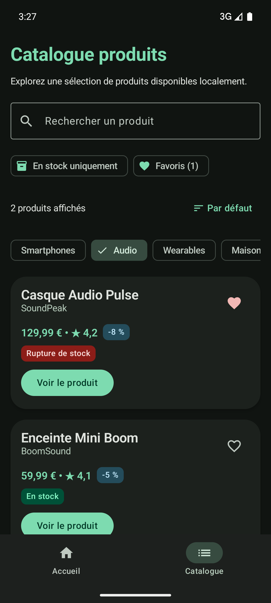
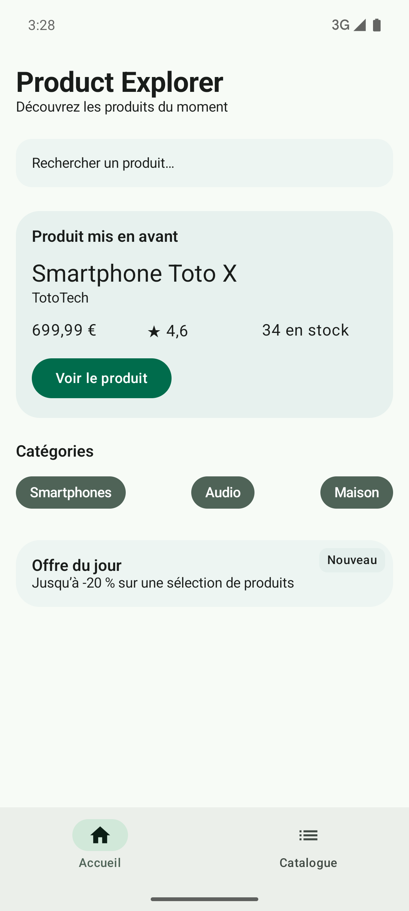
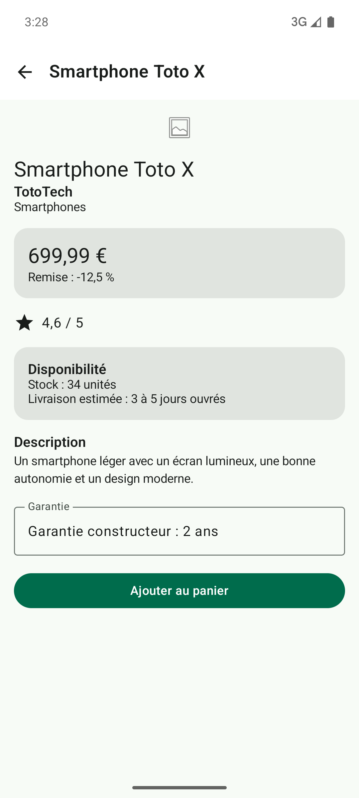

# Product Explorer — Fil rouge Jetpack Compose

ESGI M1 — Développement Android avec Jetpack Compose — Ethan Rieu (Reims)

Application fil rouge construite TP après TP : un explorateur de produits avec un écran d'accueil, un catalogue interactif (recherche, filtres, tri, favoris) et une fiche détaillée par produit. Toutes les données sont locales, écrites directement en Kotlin.

## Captures

| Catalogue (clair) | Catalogue (sombre) | Accueil | Détail |
|---|---|---|---|
|  |  |  |  |

## Évolution du projet (TP)

| TP | Contenu | Notions |
|---|---|---|
| **TP4** | Écran de détail produit | `Text`, `Image`, `Icon`, `Card`, `Button`, `OutlinedTextField`, composables réutilisables, previews |
| **TP5** | Écran d'accueil | `Column`, `Row` + `weight`, `Box` + `align`, `Spacer`, `Surface` |
| **TP6** | Catalogue local de produits | `LazyColumn`, `LazyRow`, `item` / `items` avec `key`, carte réutilisable `ProductListItem` |
| **TP7** | Personnalisation graphique | Material Design 3 : `ColorScheme` clair / sombre, `Typography`, `Shapes` |
| **TP8** | Catalogue interactif | `remember`, `mutableStateOf`, `rememberSaveable` : recherche, filtre stock, favoris |
| **TP9** | State Hoisting | `ProductCatalogContainer` (stateful) / `ProductCatalogScreen` (stateless) : les données descendent, les événements remontent |
| **TP10** | Gestion de l'écran avec un ViewModel | `ViewModel`, `viewModel()`, `mutableStateOf` avec `private set`, fonctions d'évènement, cycle de vie |

Chaque fin de TP est marquée par un tag Git : `tp4-final` · `tp5-final` · `tp6-final` · `tp7-final` · `tp8-final` · `tp9-final` · `tp10-final`.

## Fonctionnalités réalisées en autonomie

- **Navigation entre les écrans** : barre de navigation Accueil / Catalogue, « Voir le produit » ouvre la fiche détaillée (barre du haut avec retour, retour système avec `BackHandler`). Depuis l'accueil, la barre de recherche ouvre le catalogue et une catégorie ouvre le catalogue déjà filtré. La navigation est un simple état Compose, conservé à la rotation, et l'état de chaque onglet (recherche, filtres, défilement) est gardé avec `rememberSaveableStateHolder`.
- **Filtre par catégorie** : chips sélectionnables (`FilterChip`), une catégorie active à la fois, re-clic pour désélectionner.
- **Favoris** : cœur plein / vide sur chaque carte (`IconToggleButton`, description accessible selon l'état) et filtre « Favoris (n) ».
- **Tri** : par défaut, prix croissant, prix décroissant, meilleures notes (menu déroulant).
- **Finitions** :
  - bouton pour effacer la recherche ;
  - message « aucun produit » avec bouton « Réinitialiser les filtres » ;
  - badges « En stock / Rupture de stock » et remise ;
  - prix et notes au format français (`699,99 €`, `4,6`) ;
  - bouton « Ajouter au panier » désactivé en rupture de stock, avec confirmation dans une snackbar.
- **Thème complété** : rôles `container` / `surface` définis en clair et en sombre, pour que la barre de navigation et les chips utilisent la palette de l'application au lieu des violets par défaut de Material 3.

Tous les filtres se combinent : recherche, stock, catégorie et favoris, puis tri.

## Organisation du code

```text
com.example.tps
├── MainActivity.kt              point d'entrée
├── data/
│   ├── ProductUi.kt             modèle
│   └── SampleData.kt            produits et catégories locaux
└── ui/
    ├── ProductExplorerApp.kt    navigation (onglets, détail, retour)
    ├── catalog/                 container + écran stateless, carte, filtres, tri, état vide
    ├── detail/                  fiche produit (TP4) + barre du haut / snackbar
    ├── home/                    écran d'accueil (TP5)
    ├── components/              composants partagés (catégories, favori, badges)
    ├── format/                  formatage des prix, notes, remises, pluriels
    └── theme/                   couleurs, typographie et formes Material 3
```

Principes suivis :

- composables **stateless** qui reçoivent des valeurs et des callbacks, avec un `modifier: Modifier = Modifier` ;
- l'état est **remonté** au plus près de l'endroit qui en a besoin ;
- la logique de filtrage et de tri est faite de **fonctions pures** (`ProductFilters.kt`), testées sans Android ;
- tous les textes sont dans `res/values/strings.xml`, avec des **pluriels** (règle française : 0 et 1 au singulier) ;
- une **preview** pour chaque écran et pour les composants principaux, en clair et en sombre pour le catalogue.

## Tests

```bash
./gradlew test                  # tests unitaires (filtres, tri, formatage)
./gradlew connectedAndroidTest  # tests d'interface Compose (émulateur ou appareil requis)
```

- `ProductFiltersTest`, `FormattersTest`, `FrenchPluralTest` (JVM) : recherche, stock, catégorie, favoris, filtres combinés, tris, formats français.
- `ProductCatalogTest` (Compose) : le catalogue avec son état, et l'écran stateless qui affiche ce qu'il reçoit et fait remonter les événements.
- `NavigationTest` (Compose) : onglets, ouverture du détail, retour (bouton et système), panier, état conservé entre les onglets.

## Lancer le projet

1. Ouvrir le dossier dans Android Studio.
2. Attendre la synchronisation Gradle.
3. Lancer la configuration `app` sur un émulateur, ou ouvrir un fichier d'écran (`ProductCatalogScreen.kt`, `ProductHomeScreen.kt`, `ProductDetailScreen.kt`…) en mode *Split* pour voir les previews.
